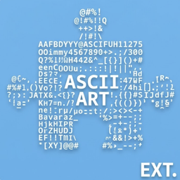
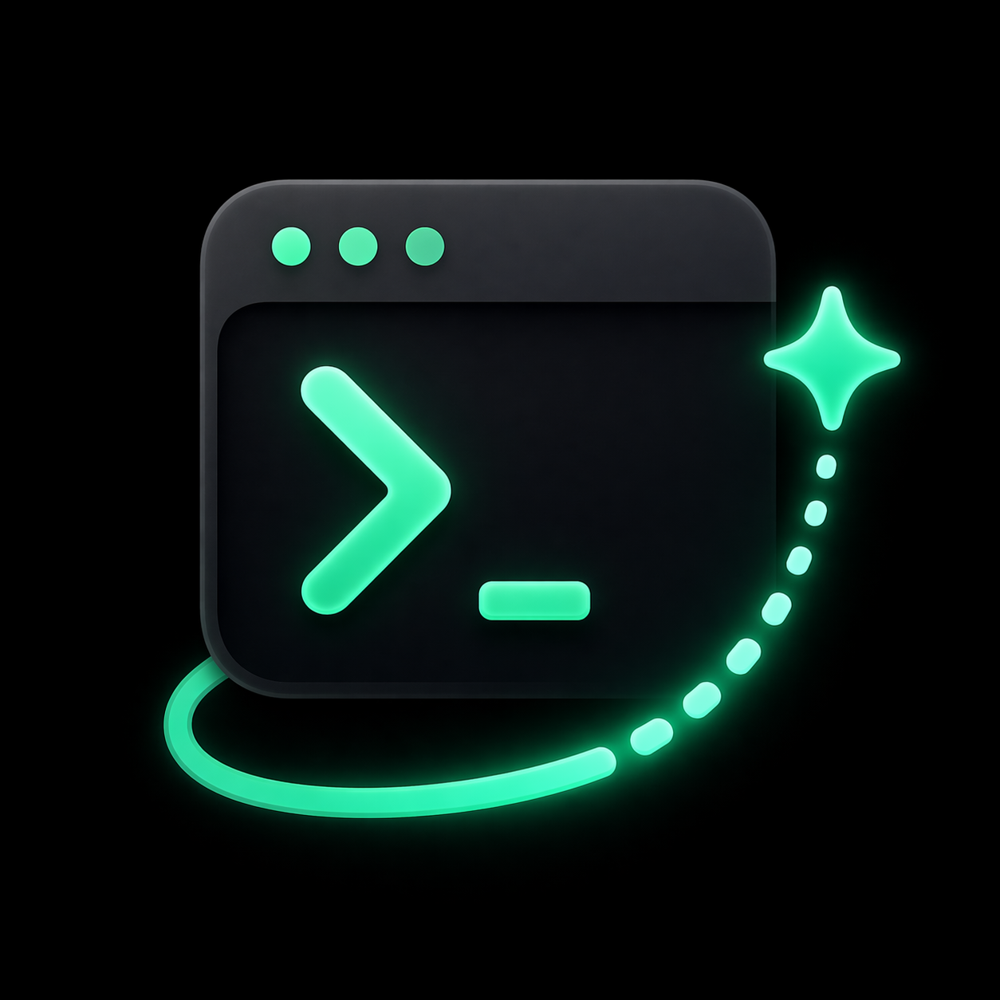
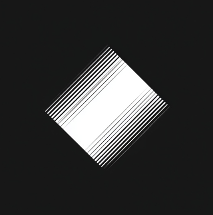
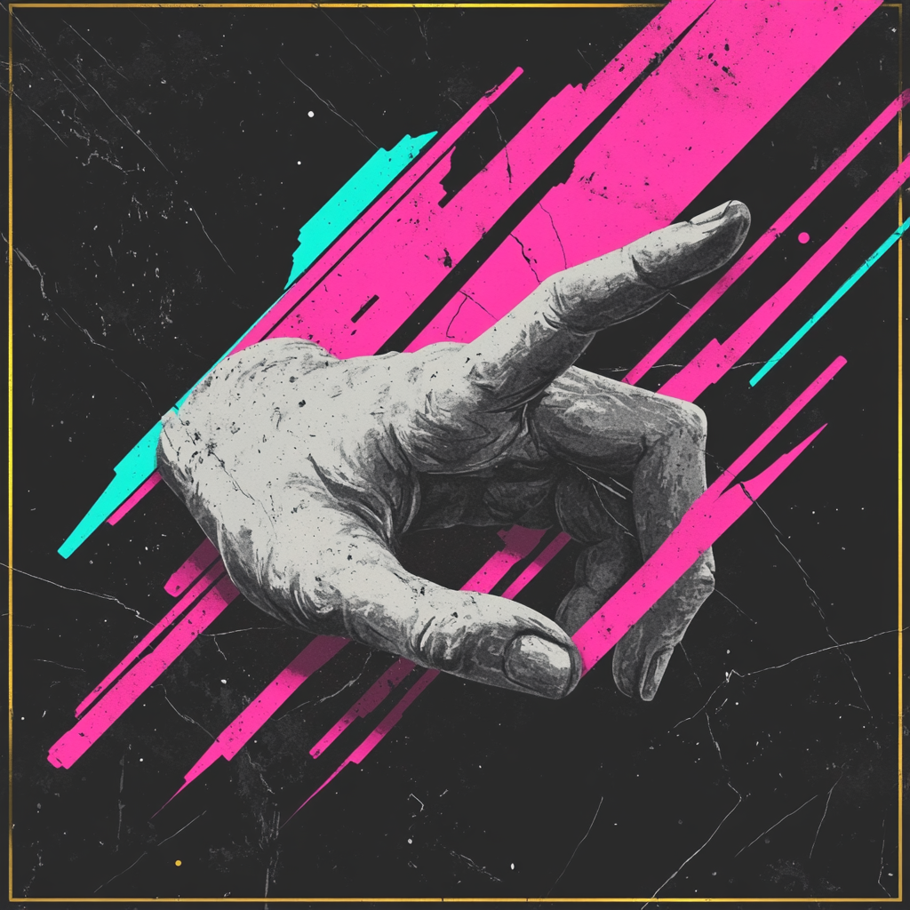

  

---

### 💥 바탕화면 부수기

 

> **예전에 하던 그 바탕화면 부수기를 맥용으로 다시 만든 게임**
>
> 망치, 전기톱, 화염방사기, 흰개미 같은 도구 9개로 지금 보이는 화면을 부숨. 실제 파일은 안 건드리고 ESC 누르면 원래대로 돌아옴

 

 

 

 

  
  

 

  

---

### 🎨 VibeBar

 

> **VS Code 탐색기 사이드바에 감성 ASCII 아트를 띄우는 확장 프로그램**
>
> 회전하는 지구, 한글 자모가 내리는 매트릭스, 컬러 라바 램프가 있고 커스텀 ASCII 아트도 띄울 수 있음

 

 

  
  
  

 

&nbsp;

  

### 🌿 White Cotton

 

> **AWS 공식 문서 보기 전에 먼저 읽는 AWS 서비스 백과사전**
>
> AWS 서비스 99개를 레벨별로 설명함. AI 아키텍처 추천이랑 다이어그램도 있음

 

 

  

 

  

---

### 🖥️ KindTerminal

 

> **Swift/AppKit으로 만든 macOS 터미널 앱**
>
> SSH 서버랑 alias를 관리할 수 있고 앱 안에서 AI 채팅도 됨. 업데이트는 Sparkle로 자동으로 받음

 

 

  
  
  
  

 

&nbsp;

  

---

### 🐛 GlitchSnap Studio

 

> **브라우저 환경 테스트부터 테스트케이스, 통계 관리까지 하는 QA용 데스크톱 앱**
>
> 브라우저를 rrweb로 녹화하거나 스크린샷을 찍고, 환경 정보는 자동으로 모음. TC는 엑셀로 관리

 

 

  

 

  

---

### 🔗 다시보기 (Dasibogi)

 

> **링크를 넣으면 AI가 분류하고 정리해 주는 데스크톱 트레이 앱**
>
> 링크를 복사하고 단축키를 누르면 내용을 분석해서 태그를 달고 카테고리를 나눔

 

 

  

 

&nbsp;

&nbsp;

  

---

### 📂 copyNpaste

 

> **SI 프로젝트에서 회사 폴더와 고객사 폴더를 맞출 때 쓰는 데스크톱 앱**
>
> 바뀐 파일을 찾고 Git 이력도 볼 수 있음. 인프라 파일이 섞이면 경고하고, 덮어쓸 파일은 골라서 덮어씀

 

 

  

 

  

---

### 🖥️ Secretary

 

> **Tailscale과 SSH로 원격 맥미니에 붙어서 파일을 GUI로 관리하는 데스크톱 앱**
>
> 탐색기처럼 파일을 보고 SFTP로 올리고 내림. 드래그 앤 드롭, 검색, 시스템 상태 확인도 됨

 

 

  

 

  

### ✨ Tech Stack

 

**Frontend**

**Mobile & Desktop**

**Backend**

**Game**

  

---

### 🛠️ Tools

 

  

---

### 💬 Contact

 

  

